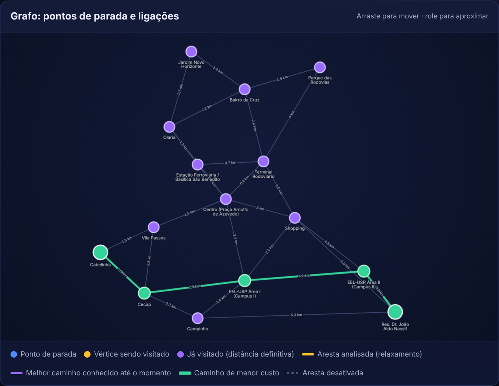

# Grafos em Ação

Trabalho Final (P2) de **Teoria dos Grafos e suas Aplicações**: três problemas reais modelados como
grafos e resolvidos com o algoritmo guloso adequado, num sistema web que mostra o resultado e o passo
a passo da execução.

| # | Problema | Algoritmo | Pergunta que o software responde |
|---|----------|-----------|----------------------------------|
| 1 | Transporte público de Lorena/SP | **Dijkstra** | Qual é o melhor caminho entre a origem e o destino escolhidos? |
| 2 | Rede de voos da LATAM no Brasil | **Prim** | Quais conexões ligam todos os aeroportos com uma única via, ao menor custo total? |
| 3 | Pavimentação dos bairros de Lorena/SP | **Kruskal** | Quais vias, de menor comprimento total, interligam todos os bairros? |

O enunciado completo está em [`docs/ENUNCIADO.md`](docs/ENUNCIADO.md).



## Como rodar

Precisa do Python 3.11+.

```bash
python -m venv .venv && source .venv/bin/activate   # Windows: .venv\Scripts\activate
pip install -r requirements.txt
python app.py          # abre em http://127.0.0.1:5000
pytest                 # testes (NetworkX só como gabarito)
ruff check .
```

## O que dá pra fazer

- escolher origem/destino (Dijkstra) ou aeroporto inicial (Prim) e executar
- ver o resultado destacado no grafo e o custo total
- ver o passo a passo da execução (anterior, próximo, reproduzir)
- clicar numa aresta para desativá-la e ver o que acontece (outra rota ou grafo desconexo)
- restaurar o grafo original

## Organização

```
app.py               servidor Flask e rotas da API
algoritmos/          dijkstra.py, prim.py, kruskal.py (puros) e grafo.py (leitura e apoio)
dados/               os 3 grafos em JSON + REFERENCIAS.md
templates/ static/   páginas HTML, CSS, JS e a biblioteca vis-network
tests/               testes (NetworkX só para comparar o resultado)
docs/                enunciado, apresentação, capturas, memória (CONTEXTO.md) e decisões (ADRs)
```

## Sobre os dados

Os nomes dos pontos, bairros e aeroportos são reais (fontes em `dados/REFERENCIAS.md`):

- **Dijkstra**: distâncias reais (rota de carro no Google Maps, 09/11/2026); quais pontos se ligam é um modelo, não o itinerário oficial.
- **Prim**: rotas reais da LATAM e duração real dos voos (ANAC VRA, set/2026); coordenadas do OurAirports.
- **Kruskal**: comprimentos reais (rota de carro entre bairros no Google Maps, 09/11/2026); os pares de bairros vizinhos são um modelo.

### Como medir os pesos no Google Maps (grátis)

Sem API e sem chave: só links que abrem a rota no navegador, então não há como gerar cobrança.

1. Abra `dados/medicoes_dijkstra.csv` ou `dados/medicoes_kruskal.csv` no Excel ou no Google Sheets.
2. Em cada linha, clique em `link_google_maps`, confira se os dois pontos caíram no lugar certo
   (corrija no próprio Maps se precisar) e anote a distância da rota em `peso_medido_km` ou
   `peso_medido_m`, só o número (`1,7` / `850`), mais `medido_por` e `data`.
3. Salve como CSV (separador `;`) e rode `python -m dados.medicoes aplicar`. O script grava o peso e
   a fonte em cada aresta, valida o grafo inteiro e não grava nada se algum valor estiver errado.

Linhas em branco são ignoradas, então dá para dividir as linhas entre o grupo e aplicar aos poucos.

### Alternativa: medir com a Routes API (paga, com travas)

O script `python -m dados.rotas_api` preenche as linhas vazias das mesmas planilhas. As 47 chamadas
ficam dentro da cota gratuita mensal do Google (10.000 de Compute Routes Essentials), **mas a API
exige conta de faturamento com cartão e cobra tudo acima da cota**. Só rode depois destas travas:

1. **Conta antiga:** em *Faturamento → Relatórios*, confira se algum projeto antigo ainda gera custo
   de Maps; desative as chaves antigas em *APIs e serviços → Credenciais*. Por segurança, trate a
   cota grátis como compartilhada entre todos os projetos da mesma conta de faturamento.
2. **Projeto novo e separado** (ex.: `grafos-em-acao`) ligado à sua conta de faturamento existente.
   Ative **somente** a *Routes API*.
3. **Chave restrita:** *Credenciais → Criar chave de API → Restrições de API → só Routes API*.
4. **Trava de gasto:** a mais forte é usar uma conta em **teste gratuito** (Google Cloud): sem
   cobrança enquanto não houver upgrade manual, então **nunca clique em "Fazer upgrade"**. Em conta
   paga, tente reduzir a cota diária em *Routes API → Cotas*; em 09/11/2026 as cotas de Compute
   Routes apareciam como **não ajustáveis**, e aí restam o teto do script e a cota grátis.
5. **Alerta de orçamento** de R$ 1 em *Faturamento → Orçamentos e alertas* (só avisa, não bloqueia).
6. Rode com a chave só na sessão do terminal (nunca em arquivo do repositório):
   ```powershell
   $env:GOOGLE_MAPS_API_KEY = "cole-a-chave-aqui"   # PowerShell; no bash: export GOOGLE_MAPS_API_KEY=...
   python -m dados.rotas_api        # mostra quantas chamadas fará e pede confirmação
   python -m dados.medicoes aplicar
   ```
7. **Depois de medir:** exclua a chave, desative a Routes API e desvincule o faturamento do projeto.

O próprio script tem teto de 60 chamadas, pede confirmação, só pede `distanceMeters` sem trânsito
(SKU Essentials), para no primeiro erro e não repete chamada para linha já medida.

## Tecnologias

Python, Flask, HTML, CSS, JavaScript, vis-network, NetworkX (só nos testes).
